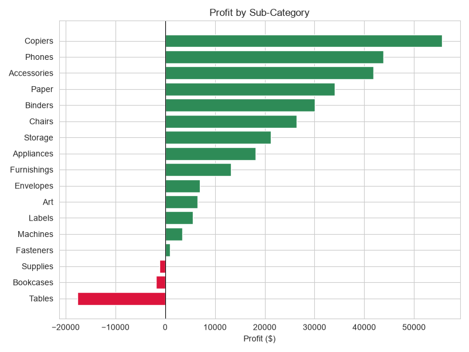
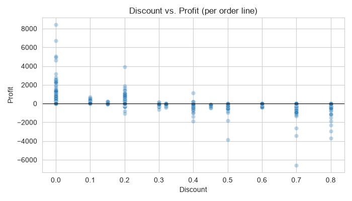
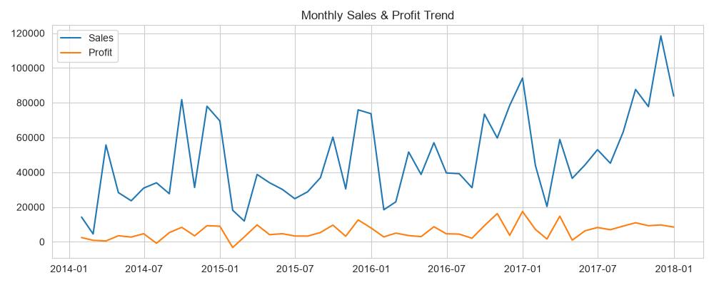

# Superstore Sales & Customer Analysis

## 🛒 Project Overview & Business Problem
Strong sales figures don't automatically mean a healthy business. A retailer can grow revenue every year and still lose money on certain products, regions, or discount decisions.

This project combines a **customer dataset** with a **sales transaction dataset** to uncover where the business makes money and where it leaks profit. By understanding which products, discount levels, regions, and customers drive results, management can make smarter pricing, inventory, and growth decisions.

## 📊 Dataset & Preparation
The project starts with two raw files joined on the customer ID:
- **Sales file:** 9,931 order lines (products, sales, quantity, discount, profit)
- **Customers file:** 793 customers (name, segment, age, location)

After combining and cleaning, the final dataset contains **9,931 order lines across 4,982 orders, 793 customers, and 21 columns**, covering **January 2014 to December 2017** across 41 US states. No records were lost in the merge, and cleaning focused on correcting values rather than dropping rows.

**Key Cleaning Steps:**
- `Sales`: stored as text (e.g. `USD25.82`), converted to a numeric value.
- `OrderDate` / `ShipDate`: converted from text to proper dates.
- `Country`: standardized 70 `US` entries to `United States`.
- `Age`: three impossible values (1000, 400, 107) set to missing rather than guessed.
- Redundant join column dropped; no duplicate rows found.

## 💡 Key Findings
1. **Profitable overall, but margins are thin:** The business generated **$2.28M in sales and $287K in profit (12.6% margin)** across 4,982 orders. Sales grew from $479K in 2014 to $733K in 2017.
2. **Heavy Discounts Destroy Profit:** Order lines with no discount earn **$67** profit on average, versus **-$78** at 21–40% off and **-$105** above 40%. The 13.9% of order lines discounted over 20% lost about **$133K combined**, equal to roughly 46% of total profit.
3. **Furniture Sells Well but Earns Little:** Furniture is 32% of sales ($733K) yet has only a **2.7% margin**, versus about 17% for Technology and Office Supplies. **Tables (-$17.7K), Bookcases (-$1.8K), and Supplies (-$1.2K)** lose money overall, while Copiers ($55.6K), Phones ($43.9K), and Accessories ($41.9K) lead on profit.
4. **The South Region Lags:** South has the lowest profit margin at **7.6%**, compared with **15.8% in the East** and 12.8% in the West.
5. **Sales Are Highly Seasonal:** **September, November, and December account for 42.8%** of total sales.
6. **Customer Base Is Healthy but Concentrated in the Top Tier:** The top 20% of customers generate **48% of sales**, while no single customer dominates (the top 10 together make up only 6.7%). Consumers are 50.4% of sales, but Home Office has the best margin (14.1%).

## Visualization

### 1. Profit by Sub-Category

### 2. Discount Level vs. Profit

### 3. Region Performance

### 4. Monthly Seasonality

## Strategic Recommendations
Based directly on the findings in the analysis, the following actions are recommended:

* **Cap Discounts at 20%:** On average, every discount tier above 20% loses money. A discount cap, or an approval step for deeper discounts, would protect margin.
* **Fix Furniture Pricing Before Cutting Lines:** Review pricing, supplier costs, and discounting on Tables and Bookcases, which sell in volume but lose money.
* **Investigate the South Region:** Its margin is half that of the East. Review discounting, product mix, and shipping costs there to find the cause.
* **Plan for the September–December Peak:** Align inventory, staffing, and promotions with the months that deliver over 40% of annual sales.
* **Promote High-Margin Products:** Copiers, Paper, and Accessories earn the strongest margins and are good candidates for promotion and cross-selling.
* **Protect the Top Customers:** With the top 20% of customers driving almost half of sales, a loyalty or retention program would safeguard revenue.

## 🛠 Tools & Skills Demonstrated
* **Languages & Libraries:** Python (Pandas, NumPy, Matplotlib, Seaborn)
* **Skills:** Combining and validating datasets, Data Cleaning (data types, inconsistent values, invalid entries, missing values, duplicates), Exploratory Data Analysis (EDA), Data Visualization, and Business Analytics.

